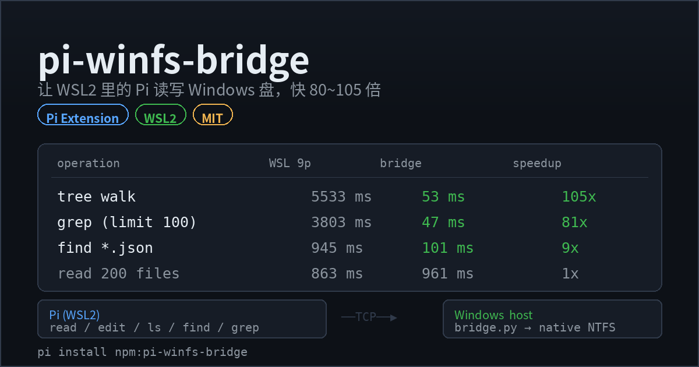

<div align="center">

# pi-winfs-bridge

**Make Windows drives on `/mnt/c`, `/mnt/d`, … as fast as native NTFS for Pi running inside WSL2.**

[](https://www.npmjs.com/package/pi-winfs-bridge)
[](./LICENSE)
[](https://pi.dev/packages/pi-winfs-bridge)

[English](#english) · [中文](#中文)



</div>

---

<a id="english"></a>

## English

A [Pi](https://pi.dev) extension. When Pi runs inside WSL2 and touches Windows drives
mounted at `/mnt/c`, `/mnt/d`, … every `stat` / `readdir` / `open` is a cross-VM RPC over
9p (drvfs). Metadata-heavy work — directory walks, `grep`, `find`, `git status` — slows
down by a factor of tens to hundreds.

This extension reroutes those file operations through a tiny native Windows helper
(pure-standard-library Python 3) that talks to NTFS directly, and runs `grep` through the
Windows-side `rg.exe`.

> **Use it when**: Pi runs in WSL2 but your projects and data live on Windows drives.
>
> **Don't use it when**: Pi runs directly on Windows, or your files are in WSL's own
> ext4. The extension detects both cases and goes dormant — it changes nothing.

### Why

Measured on this machine (`C:\Users\<you>\AppData\Local\Packages`, 4928 files):

| Operation | WSL over 9p | Native NTFS | Speedup |
|---|---|---|---|
| Directory tree walk | 7.2 ~ 7.8 s | 0.10 ~ 0.13 s | **~80x** |
| Read 200 files (52 MB) | 2.63 s | 0.05 s | **52x** |
| Single `stat` | 0.16 ms | 0.01 ms | 16x |
| Single `readdir` | 0.90 ms | 0.02 ms | 45x |

End-to-end through the extension's real code path (4927 files / 46 MB):

| Scenario | WSL over 9p | Bridged | Speedup |
|---|---|---|---|
| Recursive tree walk | 5533 ms | **53 ms** | **105x** |
| `grep` (Pi default limit=100) | 3803 ms | **47 ms** | **81x** |
| `find *.json` | 945 ms | **101 ms** | 9x |
| `read` 200 files (pure payload) | 863 ms | 961 ms | even |

> Gains concentrate in **metadata-heavy** operations (ls / find / grep / tree / git status).
> Bulk content reads are a wash — there the bottleneck is the bytes themselves, not the
> filesystem boundary.

### Install

**Option 1 — npm (recommended)**

```bash
pi install npm:pi-winfs-bridge
```

Pin a version: `pi install npm:pi-winfs-bridge@1.0.1`

**Option 2 — git source**

```bash
pi install git:github.com/linji3/pi-winfs-bridge
```

Pin a tag: `pi install git:github.com/linji3/pi-winfs-bridge@v1.0.0`

**Option 3 — local checkout**

```bash
git clone https://github.com/linji3/pi-winfs-bridge
pi install ./pi-winfs-bridge
```

**Option 4 — manual copy**

```bash
mkdir -p ~/.pi/agent/extensions/winfs-bridge
cp pi-winfs-bridge/extensions/winfs-bridge/* ~/.pi/agent/extensions/winfs-bridge/
```

Pi loads it on startup. **No configuration needed.**

**Requirements**

* WSL2 (a drvfs entry in `/proc/mounts`)
* **Python 3.8+** on the Windows side (`where python` must resolve)
* `rg.exe` preferred (optional — the Windows-side Python fallback covers it)

### How it works

```
  Pi (WSL2, ext4)                      Windows host
  ┌────────────────────┐              ┌──────────────────────────────┐
  │ winfs-bridge ext   │  TCP (WSL vNIC) │ bridge.py (Python 3, stdlib) │
  │ read/write/edit    │ ───────────▶ │ calls NTFS APIs directly     │
  │ ls/find/grep       │              │ grep via Windows rg.exe      │
  └────────────────────┘              └──────────────────────────────┘
```

* The extension parses `/proc/mounts` and maps every drvfs mount (`/mnt/c` → `C:\`).
* The built-in `read` / `edit` / `ls` / `find` / `grep` tools are **re-registered with
  Pi's own definitions**; only the underlying file I/O is swapped for bridge calls.
  Fuzzy matching, diffs, truncation and rendering stay byte-identical.
* **`write` is deliberately not intercepted.** It is a contested name (ccstyle and
  similar register rich-diff variants) and first registration wins. Writing a small file
  over 9p costs ~7 ms anyway — not worth shadowing someone else's feature. Edit files
  through `edit`; that path is already full speed.
* `grep` runs `rg.exe` on the Windows side (native NTFS traversal, native `.gitignore`
  semantics) and returns `--null` output, with paths normalized back to relative POSIX.
* **Paths outside Windows drives (WSL ext4) keep the original code path**, untouched.
* If the bridge is unavailable it falls back to native 9p: slower, never broken. A killed
  bridge process is restarted automatically.

On first use it will:

1. copy `bridge.py` into the Windows temp dir (`%TEMP%\pi-winfs-bridge\`);
2. launch `python bridge.py` on Windows via WSL interop;
3. handshake over a random token and random port (token auth plus an `--allow-root`
   allowlist). The port is read from the child's stdout — drvfs caches file writes, so a
   Windows-written file can take seconds to appear inside WSL; the stdout handshake
   brings cold start from ~12 s down to ~0.2 s.

Later sessions **reuse** the running Windows process (validated by script SHA-256, so a
version bump restarts it) — one Pi session does not leak one `python.exe`.

### Usage

**Model side (automatic).** Use `read` / `edit` / `ls` / `find` / `grep` as usual with a
`/mnt/c/...` path and you get native Windows speed. **No prompt changes required.**

An extra `winfs` tool exposes Windows-side operations directly:

```
winfs op=tree  path=/mnt/c/Users/me/Documents maxDepth=3
winfs op=stat  path=/mnt/c/Users/me/Desktop/x.xlsx
winfs op=list  path=/mnt/c/Users/me/Desktop
winfs op=grep  path=/mnt/c/Users/me/Documents pattern="invoice"
winfs op=find  path=/mnt/c/Users/me pattern=*.pdf
winfs op=read  path=/mnt/c/Users/me/notes.md
```

**Human side.**

| Command | Effect |
|---|---|
| `/winfs-status` | Bridge state, mount mapping, and a live 9p vs native benchmark |
| `/winfs-bench [path]` | Benchmark only |

**Temporarily disable**

```bash
WINFS_BRIDGE=0 pi            # or
touch ~/.pi/agent/winfs-bridge.disabled
```

### Development

```bash
git clone https://github.com/linji3/pi-winfs-bridge
cd pi-winfs-bridge
npm test          # full regression (creates a temp dir on a Windows drive)
npm run bench     # 9p vs bridged benchmark
npm run selftest  # kill the Windows helper, confirm reads still work (restart/fallback)
```

The test harness locates `@earendil-works/pi-coding-agent` and `jiti` from your local Pi
install; nothing is hard-coded. Override with:

| Variable | Meaning |
|---|---|
| `WINFS_TEST_DIR` | Windows-side scratch dir, default `/mnt/c/Users/$USER/winfs-bridge-test` |
| `PI_CODING_AGENT_DIR` | Pi config directory |
| `PI_MANAGED_INSTALL_ROOT` | Pi managed install root |

Regenerate the gallery card with `python3 scripts/make-preview.py` (needs Pillow).

### Troubleshooting

| Symptom | Fix |
|---|---|
| Status bar shows `winfs bridge offline` | Run `/winfs-status` for detail; check `where python` on Windows |
| Windows Firewall prompt | Allow "Private networks" (the bridge binds only the WSL vNIC address, never public) |
| Bridge process killed | Nothing to do — the next call respawns it |
| `npm test` cannot find Pi | Ensure Pi is installed on the same machine, or set `PI_MANAGED_INSTALL_ROOT` |
| Want it always-on | Run `bridge.py --host <WSL gateway IP> --port 7411 --token <token> --allow-root C:\` from a Windows scheduled task |

### Optional: tune 9p itself

The bridge already sidesteps the 9p metadata bottleneck, so this is optional (it makes
`chmod` and friends actually take effect):

```ini
# /etc/wsl.conf
[automount]
options="metadata,umask=22,fmask=11"
```

Then `wsl --shutdown` from Windows and reopen.

### Caveats

* **The bash tool is not affected.** Running `rg` / `find` / `git status` inside bash on a
  Windows drive still goes over 9p. Prefer the `grep` / `find` tools; run `git` on the
  Windows side.
* Security boundary: the bridge listens only on the WSL virtual NIC address, handshakes
  with a random token, and may only access the roots of mounted Windows drives.
* License: MIT.

---

<a id="中文"></a>

## 中文

一个 [Pi](https://pi.dev) 扩展。装在 WSL2 里的 Pi，读写 `/mnt/c`、`/mnt/d` 之类的
Windows 盘时，会自动改走一个运行在 Windows 侧的小服务，绕开 drvfs/9p 的元数据瓶颈。

> **适用场景**：Pi 跑在 WSL2 里，但项目/资料放在 Windows 盘上。
>
> **不适用**：Pi 直接跑在 Windows 上，或者文件都在 WSL 的 ext4 里（扩展会自动退出，
> 什么都不做）。

### 为什么需要它

WSL2 通过 9p/Plan9（drvfs）把 Windows 磁盘挂到 `/mnt/c`、`/mnt/d`…… 每一次
`stat` / `readdir` / `open` 都是一次跨到 Windows 主机的 RPC。**元数据密集型**的操作
（遍历目录树、grep、find、git status）会被拖垮几十倍。

本机实测（`C:\Users\<你>\AppData\Local\Packages`，4928 个文件）：

| 操作 | WSL 走 9p | Windows 原生 NTFS | 倍数 |
|---|---|---|---|
| 遍历目录树 | 7.2 ~ 7.8 s | 0.10 ~ 0.13 s | **~80x** |
| 读 200 个文件（52 MB） | 2.63 s | 0.05 s | **52x** |
| 单次 `stat` | 0.16 ms | 0.01 ms | 16x |
| 单次 `readdir` | 0.90 ms | 0.02 ms | 45x |

端到端实测（走扩展真实代码路径，4927 个文件 / 46 MB）：

| 场景 | WSL 走 9p | 桥接 | 倍数 |
|---|---|---|---|
| 递归遍历目录树 | 5533 ms | **53 ms** | **105x** |
| `grep`（Pi 默认 limit=100） | 3803 ms | **47 ms** | **81x** |
| `find *.json` | 945 ms | **101 ms** | 9x |
| `read` 200 个文件（纯内容传输） | 863 ms | 961 ms | 持平 |

> 收益集中在**元数据密集型**操作（ls / find / grep / tree / git status）；纯大文件
> 内容读取两者持平——瓶颈变成数据量本身，不再是文件系统边界。

### 安装

**方式一：从 npm 安装（推荐）**

```bash
pi install npm:pi-winfs-bridge
```

固定版本：`pi install npm:pi-winfs-bridge@1.0.1`

**方式二：从 git 源安装**

```bash
pi install git:github.com/linji3/pi-winfs-bridge
```

固定到某个版本：`pi install git:github.com/linji3/pi-winfs-bridge@v1.0.0`

**方式三：从本地目录安装**

```bash
git clone https://github.com/linji3/pi-winfs-bridge
pi install ./pi-winfs-bridge
```

**方式四：手动放进去**

```bash
mkdir -p ~/.pi/agent/extensions/winfs-bridge
cp pi-winfs-bridge/extensions/winfs-bridge/* ~/.pi/agent/extensions/winfs-bridge/
```

Pi 启动时自动加载，**无需任何配置**。

**要求**

* WSL2（`/proc/mounts` 里有 drvfs 挂载）
* Windows 上有 **Python 3.8+**（`where python` 能找到即可）
* 有 `rg.exe` 更佳（没有也能用，Windows 端 Python 兜底）

### 原理

```
  Pi (WSL2, ext4)                      Windows 主机
  ┌────────────────────┐              ┌───────────────────────────┐
  │ winfs-bridge 扩展   │  TCP(WSL 网卡) │ bridge.py (Python 3, 纯标准库)│
  │ read/write/edit    │ ───────────▶ │ 直接调 NTFS API            │
  │ ls/find/grep       │              │ grep 走 Windows 端 rg.exe   │
  └────────────────────┘              └───────────────────────────┘
```

* 扩展解析 `/proc/mounts`，识别所有 drvfs 挂载点（`/mnt/c` → `C:\`）。
* 内置的 `read` / `edit` / `ls` / `find` / `grep` 用 **Pi 自己的定义**重新注册，
  只把底层文件操作换成桥接调用——模糊匹配、diff、截断、渲染全部保持原样。
* **`write` 故意不接管**：它是个抢手名字（ccstyle 之类会注册带富 diff 的版本），
  谁先注册归谁。而 9p 写一个小文件只要 ~7 ms，本来就不值得为它去顶掉别人的功能。
  改文件走 `edit`，那条路是全速的。
* `grep` 改成在 Windows 侧用 `rg.exe` 跑（原生 NTFS 遍历 + 原生 .gitignore 语义），
  原始输出用 `--null` 格式回传，路径统一还原成相对 POSIX 路径。
* **不在 Windows 盘上的路径（WSL 的 ext4）完全走原逻辑**，不受影响。
* 桥接不可用时自动回退到原生 9p 路径：慢，但不会坏；桥接进程被杀掉会自动重启。

首次使用时它会：

1. 把 `bridge.py` 复制到 Windows 临时目录（`%TEMP%\pi-winfs-bridge\`）；
2. 通过 WSL interop 在 Windows 上启动 `python bridge.py`；
3. 用随机 token + 随机端口握手（token 认证 + `--allow-root` 目录白名单）。端口从子进程
   stdout 读取——drvfs 的文件缓存会让 Windows 写的文件在 WSL 里延迟数秒才可见，走
   stdout 握手能把冷启动从 ~12 s 压到 ~0.2 s。

后续会话会**复用**已经跑着的那个 Windows 进程（用脚本 SHA-256 校验版本，版本变了才
换新进程），所以不会每开一个 Pi 会话就多留一个 python。

### 用法

**模型侧（自动）**

模型照常用 `read` / `edit` / `ls` / `find` / `grep`，路径给 `/mnt/c/...`
就会自动走 Windows 原生速度。**不需要改提示词**。

额外的 `winfs` 工具可以直接做 Windows 侧操作：

```
winfs op=tree  path=/mnt/c/Users/me/Documents maxDepth=3
winfs op=stat  path=/mnt/c/Users/me/Desktop/x.xlsx
winfs op=list  path=/mnt/c/Users/me/Desktop
winfs op=grep  path=/mnt/c/Users/me/Documents pattern="发票"
winfs op=find  path=/mnt/c/Users/me pattern=*.pdf
winfs op=read  path=/mnt/c/Users/me/notes.md
```

**人侧**

| 命令 | 作用 |
|---|---|
| `/winfs-status` | 显示桥接状态、挂载点映射，并当场跑一次 9p vs 原生测速 |
| `/winfs-bench [路径]` | 单独跑测速对比 |

**临时关掉**

```bash
WINFS_BRIDGE=0 pi        # 或者
touch ~/.pi/agent/winfs-bridge.disabled
```

### 开发与测试

```bash
git clone https://github.com/linji3/pi-winfs-bridge
cd pi-winfs-bridge
npm test        # 全量回归（需要在 Windows 盘上建临时目录跑）
npm run bench   # 9p vs 桥接测速
npm run selftest # 杀掉 Windows 侧 helper 后确认还能读（自动重启/回退）
```

测试脚本会自动从本机 Pi 安装里找到 `@earendil-works/pi-coding-agent` 和 `jiti`，
不写死任何路径。可用环境变量覆盖：

| 变量 | 说明 |
|---|---|
| `WINFS_TEST_DIR` | 测试用的 Windows 盘目录，默认 `/mnt/c/Users/$USER/winfs-bridge-test` |
| `PI_CODING_AGENT_DIR` | Pi 配置目录 |
| `PI_MANAGED_INSTALL_ROOT` | Pi 托管安装根目录 |

画廊预览图用 `python3 scripts/make-preview.py` 重新生成（需要 Pillow）。

### 故障排查

| 现象 | 处理 |
|---|---|
| 状态栏显示 `winfs bridge offline` | `/winfs-status` 看 detail；Windows 上确认 `where python` 有输出 |
| Windows 防火墙弹窗 | 允许「专用网络」访问（桥接只绑 WSL 虚拟网卡地址，不对外暴露） |
| 桥接进程被杀 | 不用管，下一次调用会自动拉起 |
| `npm test` 报找不到 Pi | 确认 Pi 装在同一台机器上，或设 `PI_MANAGED_INSTALL_ROOT` |
| 想要常驻 | Windows 计划任务/启动项里跑 `bridge.py --host <WSL网关IP> --port 7411 --token <token> --allow-root C:\` |

### 可选：给 9p 本身加料

桥接已经绕开了 9p 的元数据瓶颈，所以这步是可选的（会让 `chmod` 等真正生效）：

```ini
# /etc/wsl.conf
[automount]
options="metadata,umask=22,fmask=11"
```

改完在 Windows 里执行 `wsl --shutdown` 再重开。

### 注意

* **bash 工具不受影响**：在 WSL 里直接跑 `rg`/`find`/`git status` 扫 Windows 盘依旧走
  9p。模型应优先用 `grep`/`find` 工具；`git` 建议在 Windows 侧执行。
* 安全边界：桥接只监听 WSL 虚拟网卡地址，握手用随机 token，并且只允许访问已挂载的
  Windows 盘根目录。
* 许可证：MIT。

---

<div align="center">

MIT © [linji3](https://github.com/linji3)

</div>
